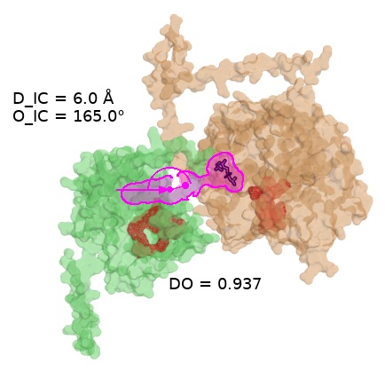
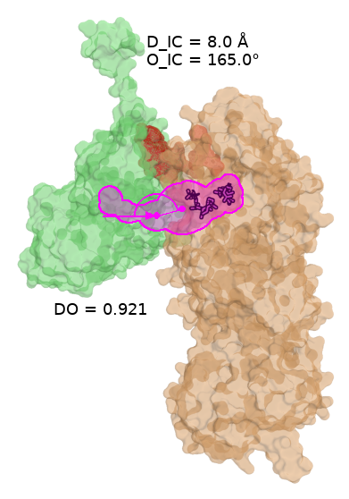
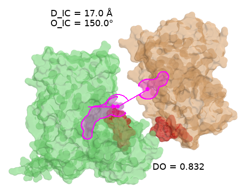
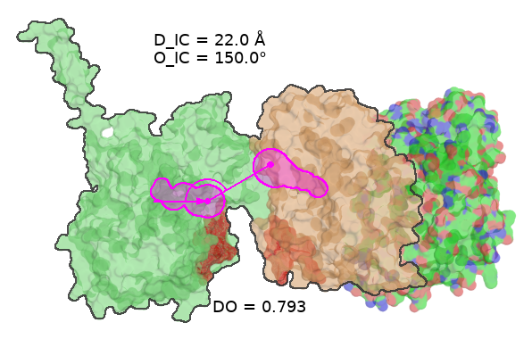

# The iMARS example set

Nineteen enzyme pairs over twenty-four enzymes, run through stages 0–5. This
is what ChannelBridge is tested against when the question is "does this work
on structures nobody prepared for it", as opposed to
[the worked example](../gdh_fnr/pair.yaml), which is curated.

Read it as a **guide to input preparation**. That is the part of the pipeline
that decides what every later number means, it is the easiest part to get
wrong quietly, and this set exists because it was got wrong here first.

```bash
export CAVER=/path/to/caver          # all 38 enzyme sides need it
export PYMOL=pymol                   # stages 3, 4 and 6; this runner's
                                     # own variable. The package itself reads
                                     # $CHBRIDGE_PYMOL.

./find_structures.py                 # 1. which coordinates per enzyme
./find_structures.py --fetch         # 2. download them
./make_af3_inputs.py                 # 3. predict the four with nothing usable
./pick_ligands.py --tsv              # 4. which ligand marks each channel
./derive_start_sites.py --tsv        # 5. where the channel starts, if no ligand
./build_inputs.py --tsv > inputs.tsv # merge + check all five against the files

./run_examples.py all                # prep, pairs, tunnels, patches, map, poses
./run_examples.py figures            # stage 6: one .pse and one SVG per pair
./run_examples.py generate           # stage 7: binder-design input per pair
./run_examples.py report             # how each tunnel was obtained
./run_examples.py check              # what in the set is not independent
./compare_to_imars.py                # our best pose vs their best fusion
./run_examples.py all --only iMARS_01_4CL-STS      # just one
```

Nothing is bundled. `_entries/` and `iMARS_*/{input,output}/` are generated
and not in version control, and so is `report.tsv`. What *is* committed is the
six decision tables (`enzymes.tsv`, `structures.tsv`, `inputs.tsv`,
`af_ligands.tsv`, `start_sites.tsv`, `pairs.tsv`), the nineteen `pair.yaml`
files, the nine scripts and the nineteen figures — every decision, and none of
the data.

---

## Input preparation

Five decisions, in order. Each has a script that makes it explicitly, a table
that records it, and a check that can fail. **`build_inputs.py` re-checks all
five against the actual files** — a named chain that is not there, or a cargo
that is not in the model, is an error rather than a row.

### 1. Which coordinates represent this enzyme

`./find_structures.py` → `structures.tsv`

| | source | why it is above the next one |
|---|---|---|
| 1 | **PDB**, an experimental structure of *this* protein | real coordinates, usually holo, possibly ChannelsDB-annotated |
| 2 | **AlphaFill** | an AlphaFold model with the cofactor transplanted from a homologous holo structure, with donor, identity, RMSD and clash count reported — so a ligand-derived start point survives |
| 3 | **AlphaFold DB** | the right protein, ligand-free: the start point must come from catalytic residues |
| 4 | **AlphaFold3** with an MSA | only when nothing above exists |

**A homolog of a different protein is not on that list.** The first version of
this set took the top hit of an RCSB sequence search per enzyme and read the
search score as closeness to the enzyme. It is not — it ranks how well a
*hit* matched the query — and only **2 of 24** entries held the enzyme they
stood for. Three rules follow, and each one changed an answer here:

* **Identity is decided by sequence, not by reputation.** UniProt's curated
  PDB cross-references are the better authority, but 19 of these 24 enzymes
  have accessions it does not index, and "the authority cannot answer" was
  being read as "no structure exists". Align instead: ≥ 95 % over ≥ 300
  aligned residues. CUS turned out 100 % identical to 3ALE, which had been in
  the candidate list the whole time.
* **Coverage is a veto.** An entry can hold the protein and not all of it.
  Require ≥ 90 % of the *aligned* reference span observed with no unobserved
  run over 30. 4CL's only experimental structure is a fusion missing its last
  **102 residues** — and 4CL's C-terminal domain closes over the active site,
  so a tunnel computed there runs out through the hole where a domain should
  be and looks like a wide channel. GGPPS's own entry is found and then
  vetoed at 89 %. Both are predicted, for a stated reason.
* **A transplant has to be usable.** AlphaFill outranks a plain model
  *because* a ligand-derived start point survives, so its best-identity
  transplant must be ≤ 2.0 clashes per heavy atom. Only the best-identity
  tier counts: accepting any usable transplant at any identity is picking by
  clash count.

The result for this set: **3 PDB, 2 switched to their own experimental entry,
10 AlphaFill, 5 AlphaFold DB, 4 predicted.**

> Prediction is defensible here even though this project measured AlphaFold
> geometry to be unreliable for iMARS fusions. That failure was
> *inter-domain* (PAE 28 Å against a ceiling of 31); intra-domain PAE was
> 3.0–5.7 Å. ChannelBridge never takes the relative placement from a
> prediction — it searches for it, one enzyme at a time.

### 2. Which chains, and what to trim

`CHAINS` and `TRIM` in `build_inputs.py`

A monomer is the cheap answer and is wrong wherever the active site is
completed across the interface. **BAS, CHS and CUS are prepared as dimers**,
because a type III PKS cavity is built partly from the partner subunit —
verified on the CHS model, where the catalytic Cys164's 12 Å neighbourhood
contains the *partner's* Met137. A class I terpene synthase or a
*trans*-prenyltransferase carries a complete site in one subunit, so those
are monomers even where the crystal has four chains.

A chain count is **asserted, not assumed**: a file with more polymer chains
than the table says is an error. Chains under 30 residues are not protomers
and are ignored by name, because AlphaFill writes a transplanted cofactor as
ATOM records in a chain of its own and a one-protomer file then looks like a
dimer.

**One enzyme is trimmed.** GGPPS's model has an 18-residue N-terminal tail
that swings 9 Å across AF3's samples, around a core of 326 of 358, sitting
where a channel mouth would be. A flailing terminus is a wall to a
sphere-rolling algorithm exactly as a water is.

### 3. Which ligand marks the channel

`./pick_ligands.py` → `af_ligands.tsv`

Ten of the 24 enzymes start from a ligand. Pick by **identity of the
transplant donor first**, never by clash count — the lowest-clash transplant
is often from a distant donor in the wrong place.

A transplant can be too clashing to *be* a start point and still mark the
right residues, because its centroid may sit inside a side chain while the
pocket it was placed into is the real one. Those cases get
`start_mode: cavity` and take their lining from the transplant's own contacts
(GES, MYS, OCS here).

### 4. Where the channel starts when no ligand marks it

`./derive_start_sites.py --tsv` → `start_sites.tsv`

Fourteen enzymes have no usable ligand. Each site is located *in the model*
and then checked against something independent — one of three routes, and the
check is the point:

| route | enzymes | validated against |
|---|---|---|
| type III PKS Cys-His-Asn triad, by geometry | CHS, CUS, STS | literature numbering, from geometry alone (CHS → Cys164/His303/Asn336) |
| class I terpene synthase `DDxxD` + `NSE/DTE` motifs | AS, NES | the metal in holo members, 2.2–3.7 Å, one hit each in 745 and 543 residues |
| a holo homolog by **local** alignment, ligand contacts give the lining | 4CL, SQS, RAS, REPI, GPPS, GGPPS | superposition RMSD 0.35–1.13 Å; worse than 3 Å is **refused** |

Two warnings from building this. A motif criterion that **validated on two
holo members** was still wrong, and only a third case with an independent
answer broke it — two agreeing validations are not a check. And a *global*
alignment mapper put REPI's site at **31.6 Å RMSD** and printed it as a
result; local alignment brings it to 0.55 Å. Use local alignment for anything
multi-domain.

### 5. Start point, cargo exclusion, and what CAVER actually measured

`./build_inputs.py --tsv` → `inputs.tsv`, then `run_examples.py tunnels`

Three rules here, all of which were violated at some point in this set and
none of which failed loudly when they were:

* **One copy of the cargo, never the mean over copies.** A pooled centroid
  over two copies that face each other is in neither of them. BAS's two HC4
  sit 29.8 Å apart and their midpoint lands inside an atom, where CAVER
  returns nothing — loud. Taxadiene synthase's two A3C sit 8.20 Å apart in
  *one chain*, and their midpoint sat 4.10 Å from either site: CAVER ran from
  it without complaint and returned tunnels of the space in between. A start
  point wrong by 4 Å does not fail, it answers a different question. Where
  one chain holds two copies the choice is arbitrary and the report says so.
* **Exclude the cargo by name whenever there is one**, not only when it also
  supplies the start point. Otherwise the cargo sits in the channel whose
  bottleneck is being measured. `pair.yaml`'s `caver.exclude` carries it.
* **Read what CAVER loaded.** Its `log.txt` prints `Atoms:` per snapshot, and
  that is the only place that says what was measured. The gap to the file is
  silent in both directions: `exclude_residue_names` removes a residue
  without a word, a starting point inside a residue removes that one too, and
  a badly clashing AlphaFill transplant is dropped by CAVER itself —
  measured here, the three GST models lose all 19 ligand atoms whether named
  or not, while a 0.50-occupancy altloc side chain is loaded. So the only
  sound bound is `loaded ≤ atoms in file − atoms excluded by name`: a deficit
  has several causes and is reported, a **surplus is an error**, and
  `report.tsv`'s `loaded` column carries the arithmetic per side.

A cache is an input too. CAVER reruns are keyed on the structure **and the
config's content**, because correcting a start point does not change the
structure — and a cache keyed on less than all of its inputs will eventually
answer out of the state its own fix was meant to replace.

### The five tables

| file | one row per | holds |
|---|---|---|
| `structures.tsv` | enzyme | which coordinates, and the reason, with what the first version used |
| `af_ligands.tsv` | enzyme | which ligand marks the channel, its donor and exactness |
| `start_sites.tsv` | enzyme | the lining residues, and which route found them |
| `inputs.tsv` | enzyme | **the table the pipeline runs from**: file, chains, cargo, kept ions, trim, start mode, start residues |
| `pairs.tsv` | pair | the two enzymes and the paper's constructs that collapse onto them |

`enzymes.tsv` is kept as the record of the first, homolog-based version.
`enzymes()` layers `inputs.tsv` over it, and **nothing should read its
`entry` or `chain` fields** — three readers did, and credited results to
coordinates no stage had opened. Provenance is `structure` + `source`;
`superseded_entry` holds the history where it cannot be mistaken for it.

---

## Where the set comes from

iMARS (Wang et al., *Cell* 188:1349, 2025) reports 36 fusion constructs. A
construct is a linker variant — fifteen of the 36 are 4CL–STS with different
linkers — and ChannelBridge does not fuse anything, so the linker is not a
variable. Collapsed on the enzyme pair, the 36 become the 19 in `pairs.tsv`.
23 of the 24 enzymes are used by a pair; CTS is prepared and unpaired.

**None of these structures is an iMARS construct**, and none is the real
enzyme in a real fusion. See [the limits](#what-this-set-does-not-do).

## The two tunnel branches

Stage 0 asks whether ChannelsDB already has tunnels for the entry being
measured. The answer is per **entry**, not per protein, so the branch is only
available where the enzyme's own coordinates happen to be an annotated PDB
entry. After every enzyme got coordinates of its own protein, that is **2 of
24** (AS and TS); the other 22 are models or unannotated entries, and the
branch is withdrawn rather than left pointing at tunnels of a protein the set
no longer uses. `report.tsv`'s `branch_changed` says so per side.

Where it is available it is still worth taking, because the two sources are
good at different things. ChannelsDB knows **what a tunnel is for** — its
categories say whether a route leads to the cognate ligand, a cofactor or the
catalytic site, which CAVER cannot tell you. What it does not give is a chain
that reaches bulk solvent: most database chains stop while still buried,
where the database's own surface definition put them. D_IC and O_IC are both
measured **at the mouth**, so a chain that stops buried has no exit and its
last sphere is not one.

So when a fetched chain does not reach the surface, **CAVER is re-run seeded
from where the database put the site**, and the result is checked back
against the database chain with `Match.recovery()` — not `Match.verdict()`,
which is exit-led and counts our deliberately longer chain's extra spheres as
misses. Seed order is the database chain's buried end first and the bound
ligand only as a rescue: seeding from the ligand first took the number of
enzymes whose CAVER route matched the annotation from 6 down to 2.

## What the run says

`./run_examples.py report`

| | |
|---|---|
| enzyme sides with a normalised tunnel | **38 of 38** |
| resolved on the CAVER branch | 36 |
| resolved by ChannelsDB-seeded CAVER | 2 (AS, TS) |
| `mouth` verdict — a usable exit | 37 |
| `recessed` | 1 (ADS) |

Neither seeded run recovered the annotated route, so both tunnels are CAVER's
own choice with no category attached. That is a real outcome and is reported
rather than smoothed over.

`./run_examples.py check` reports **19 pair files, 19 distinct computations**:
no two enzymes are measured by the same file, chains, cargo, trim and start
point. That was not true of the first version, where four enzymes shared two
stand-in structures.

## Stage 6: one session and one SVG per pair

```bash
./run_examples.py figures                      # 800 x 600, ~8 min per pair
./run_examples.py figures --width 2000 --height 1500    # print, ~6x longer
```

Two commands per pair, in that order, because choosing the camera is a human
act: `chbridge session` builds the `.pse`, `chbridge render` draws from
whatever session it is pointed at — including one you opened, rotated and
saved. The SVG is editable: the proteins are a transparent raster and
everything else (channel fill and outlines, the D_IC line, the O_IC arm and
arc, every label) is vector with named ids.

**The one argument that is not boilerplate is `tunnel_up_ref` /
`tunnel_dn_ref`.** Each tunnel is in the frame of the *prepped* enzyme, not
of the pose, so it has to be carried onto the placement. Leave the reference
out and nothing fails: both channels are drawn where the unposed enzymes had
them, and the session measures and labels a geometry belonging to no
placement at all — on pair 02 that was **D_IC 38.0 Å / DO 0.538** against the
pose's own 6.0 Å / 0.937, with every step exiting 0. `chbridge session` now
compares its own geometry against the pose's and refuses the mismatch, so
this is a note rather than a trap.

**Colours** (defaults; every role is overridable through the style):

| | |
|---|---|
| upstream enzyme, left | green, 65 % transparent |
| downstream enzyme, right | orange, 65 % transparent |
| the channel — 2D fill and outline | **red** |
| the hotspot patch this pose bridges, on both enzymes | **red**, solid |
| D_IC line, exit dots, O_IC arm, arrowhead, arc, labels | **magenta** |
| cofactors | purple sticks |

The committed copies are in [figures/](figures/), one per pair — the editable
`.svg`, and a flat `.png` beside it because the sanitiser GitHub puts in
front of an SVG in a README drops the embedded protein raster.

| | |
|---|---|
|  |  |
| **02 GPPS–MYS** — the tightest pair in the set: D_IC 6 Å, O_IC 165°, DO 0.937. The two channels meet across the interface. ([svg](figures/iMARS_02_GPPS-MYS.svg)) | **08 GGPPS–TS** — D_IC 8 Å, DO 0.921. One of the two pairs with a ChannelsDB-seeded tunnel (TS here, AS in pair 14); neither recovered the annotated route, so both are CAVER's own choice. ([svg](figures/iMARS_08_GGPPS-TS.svg)) |
|  |  |
| **12 4CL–RAS** — D_IC 17 Å, DO 0.832. The narrowest margin over iMARS's own fusion (+0.0129), and the only pair where their D_IC is shorter than ours. ([svg](figures/iMARS_12_4CL-RAS.svg)) | **18 4CL–CUS** — D_IC 22 Å, DO 0.793, the widest D_IC and lowest DO in the set, and the slowest search: 56,877 grid points evaluated before five poses were feasible, against 1,925 for pair 02. ([svg](figures/iMARS_18_4CL-CUS.svg)) |

## Stage 7: binder-design input

```bash
./run_examples.py generate                     # RFD4-Proteina + RFdiffusion3
./run_examples.py generate --tool BindCraft
chbridge generate --list-tools
```

Each pair's best pose becomes one spec per tool, carrying the pose geometry
and the hotspots of both enzymes:

```yaml
iMARS_02_GPPS-MYS_geom001:
  input: iMARS_02_GPPS-MYS_geom001.cif
  contig: "100-150, /0, A1-381, /0, B1-597"
  conditions:
    C_CRD: {true: [{select: "sel('A')"}, {select: "sel('B')"}]}
    C_SEQ: {true: [{select: "sel('A')"}, {select: "sel('B')"}]}
    C_HOT: {true: [{select: "sel('A/*/87/[CZ,CE1,CE2]')"}, ...]}
```

**`C_CRD`, never `C_CRDGRP` per chain.** `C_CRDGRP` preserves a group's
internal geometry and leaves its global pose free, so with two targets it
releases the inter-enzyme placement — which *is* the output of stages 2–5 —
and discards D_IC and O_IC without failing. Every generated file says so.

Kept cofactors fall outside the contig and the generator warns when it sees
one, because a design built against a site the model cannot see is a
different design: for pair 02 the GST is in the structure and not in the
spec.

**Hotspots are chosen, not copied.** A patch here is 7–14 residues, and the
generator is handed the five (`--n-hotspots`) a binder can lock onto: the
exposed F/Y/W/I/L/M, spread along the sequence so they span the epitope. On
this set most patches offer only three or four, and the generator says so
rather than padding the list — GPPS patch 2 is ten residues and four
anchors. RFdiffusion3 gets its own `TIP` keyword for each, which is why no
`CA`/`CB` entry appears: Ala, Gly and Pro have no tip and are never anchors.

### Three ways to ask for the binder

```bash
./run_examples.py generate                        # bispecific, the default
chbridge generate <pair>/output --mode monospecific
chbridge generate <pair>/output --mode context --context-cut 30
```

| `--mode` | jobs | the partner is | the pose geometry is |
|---|---|---|---|
| `bispecific` | 1 | a second target | **in the job** |
| `monospecific` | 2 | absent | not in it at all |
| `context` | 2 | present, cropped, not targeted | in the job |

`context` crops the partner to the residues within `--context-cut` of the
epitope, which is BindCraft's "trim the input only to the parts necessary to
facilitate correct binding" done as a measurement. On pair 02 that takes the
MYS side from 597 residues to 89, and the whole job from 1,128 residues to
620 — the difference between BindCraft's guidance for an 80 GB card and over
it. `chbridge generate` prints the arithmetic for every job.

The default cut is 30 Å, measured on this set rather than inherited: the
nearest partner atom sits 8.7–34.6 Å from the epitope (median 15.2), so 20 Å
reaches the partner on 28 of the 38 sides and 30 Å on 37. Where nothing is
within the cut, the job becomes the monospecific one and says so — that is a
fact about the pair, not a failure.

Two caveats BindCraft gives that a distance cut cannot honour: a trim should
fall at a domain boundary or a hinge, and it should not expose a hydrophobic
core. Look at what comes out before trusting it on a new target.

## Against iMARS's own predictions

`./compare_to_imars.py` puts our best pose beside iMARS's own rank-1 linker
fusion for the same pair (their Table S2G), on the same DO coefficients. It
needs your own copy of their supplement, which is copyrighted and not
redistributed here:

```bash
export CHANNELBRIDGE_IMARS_ST2=/path/to/1-s2.0-S0092867424014715-mmc3.xlsx
./compare_to_imars.py
```

Over all **19 distinct** pairs, our best feasible pose scores higher for
**19 of 19**, by a median of **+0.1518 DO** (min +0.0129, max +0.4193).

| | ours | iMARS |
|---|---|---|
| D_IC range | 6–22 Å | 10.1–55.3 Å |
| best pair | 0.9371 (02 GPPS–MYS, 6 Å) | 0.8342 (13 ERG20–GGPPS, 19.5 Å) |
| worst pair | 0.7927 (18 4CL–CUS, 22 Å) | 0.5178 (02 GPPS–MYS, 55.3 Å) |

**That is not a contest, and the gap is not a result about enzymes.** DO
falls 0.0079 per angstrom of D_IC and almost the whole difference is D_IC. A
terminal fusion cannot choose where the two channel exits end up — it gets
whatever the construct folds into — whereas a pose search is limited by the
two surfaces instead of by the chain termini. The comparison measures how
much geometric room the binder route has that the fusion route does not.

The narrowest row is the most informative: **4CL–RAS, +0.0129**. Their fusion
already lands the exits 10.1 Å apart — the tightest in their set — and our
search is carrying two requirements theirs is not, 6 Å of clearance for a
binder *and* an epitope pair with a clear line between them. Where the fusion
geometry is already tight, those constraints cost about as much as the
freedom buys. It is the one pair where our D_IC (17 Å) is *worse* than
theirs.

Read `compare_to_imars.py`'s docstring before quoting any of this: 15 of our
24 structures are models, theirs are AlphaFold2 models of the real fusions,
and a feasible pose is a geometry a binder *could* occupy — not a binder.
iMARS measured yields; we have measured nothing.

### How their numbers were produced

Their supplement publishes the scripts as well as the data (Table S7 in
`mmc8.xlsx`), and `docs/imars-verification.md` §2 reads them line by line.
Three things from `S7E`, "Molecular docking and channel calculation", matter
for comparing against them:

* `tun_cl_001_1.pdb` is **hard-coded** — CAVER's cluster 1, with no priority
  floor, no length filter and no check that the chain reaches solvent.
* P1 is the literal second-to-last sphere and `last_indel_A_1` is computed
  **for A only**, which confirms from their own code that O_IC is one-sided
  and measured on the upstream channel. `channelbridge.geometry` agrees.
* nothing truncates the chain at the surface, so P2 is wherever cluster 1
  happens to stop — which is set by a shell radius in a config file the
  supplement does not include. That is the mechanism behind their 10–55 Å
  D_IC spread, and the reason ChannelBridge normalises before measuring.

## Choices here that are not the package's defaults

* **The ChannelsDB pick rule** is: at least 5 Å long, attached to the chain
  that was prepared, then a chain that leaves the protein, then the widest
  bottleneck. CAVER ranks by *priority* (throughput) and no ChannelsDB report
  carries it, so a mixed pair can have one tunnel chosen by throughput and
  one by bottleneck. That is a difference between the branches, not between
  the enzymes.
* **The downstream enzyme is renamed to chain B** at prep. Most of these
  entries have only chain A, and `chbridge validate` rejects a pair whose
  targets share a chain. Renaming is not moving, so the ChannelsDB branch is
  unaffected — a database sphere chain carries coordinates and no chain id.
* **`site` and `vent`** are the ligand where there is one and the catalytic
  residues where there is not. Neither is narrowed to a reactive atom,
  because for most of these enzymes nobody here knows which atom that is, and
  a guess written as a selection would read as knowledge.
* **The pose grid is left at the package default** for all 19 pairs. A
  per-pair grid would be a claim about these enzymes that this set does not
  support.

## What this set does not do

**The stage-4 hotspot maps are not poses.** They place the two enzymes at the
closest, best-oriented corner of the default grid, computed before any search
(`reference_pose.py`); the D_IC, O_IC and DO written into each session are
that grid corner. Stage 5's `poses.tsv` is where the searched geometry is.

**The occupancy filter is never exercised.** Every UPSTREAM enzyme is prepped
as a single protomer (BAS, CHS and CUS are dimers, but all three are
downstream), so there is nothing to tile and the test turns itself off.
That is a gap in the set, not in the filter — it was checked separately by
prepping both equivalent protomers of GPPS (3KRF chains A and D) and
searching that against LIC, where **24 of 25 otherwise-feasible poses fail**
because the two LIC copies would interpenetrate.

**Nothing here is a prediction about whether any of these 19 pairs would
channel, or about the yields iMARS measured.** The structures are the right
proteins now, but 19 of 24 are models, two tunnels are CAVER's own choice
with no annotation behind them, and a feasible pose is a geometry a binder
*could* occupy — not a binder, and not a working channel. The set
demonstrates that stages 0–5 work on uncurated input and shows where they
stop being trustworthy. It is not a result about these enzymes.
